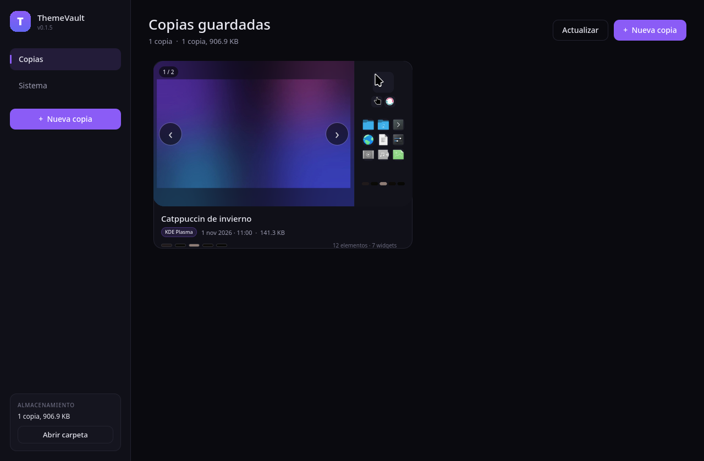
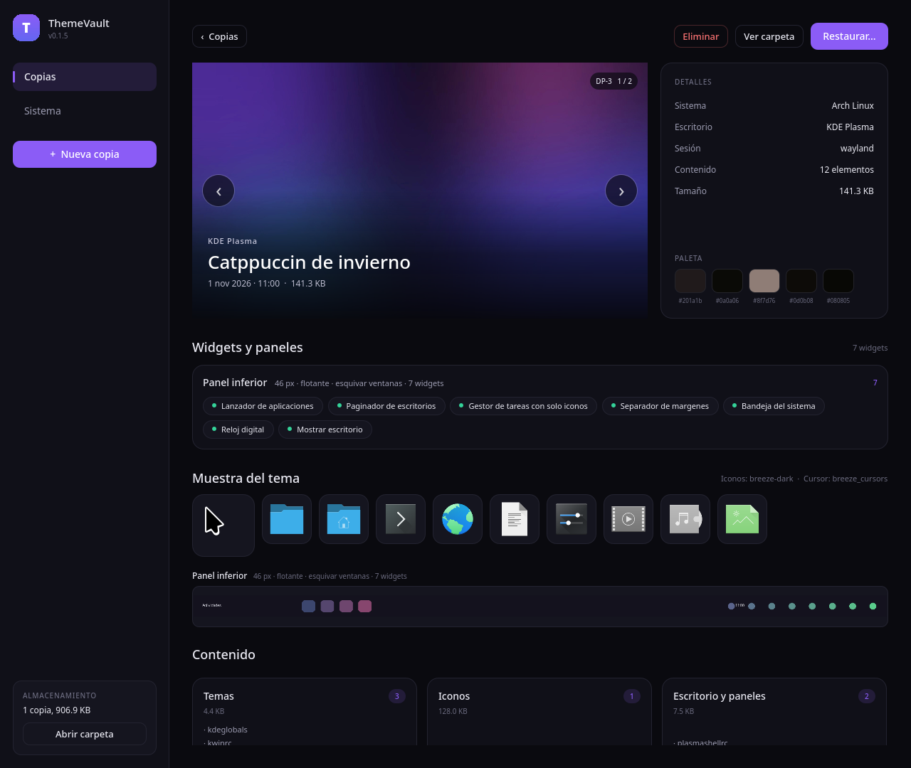
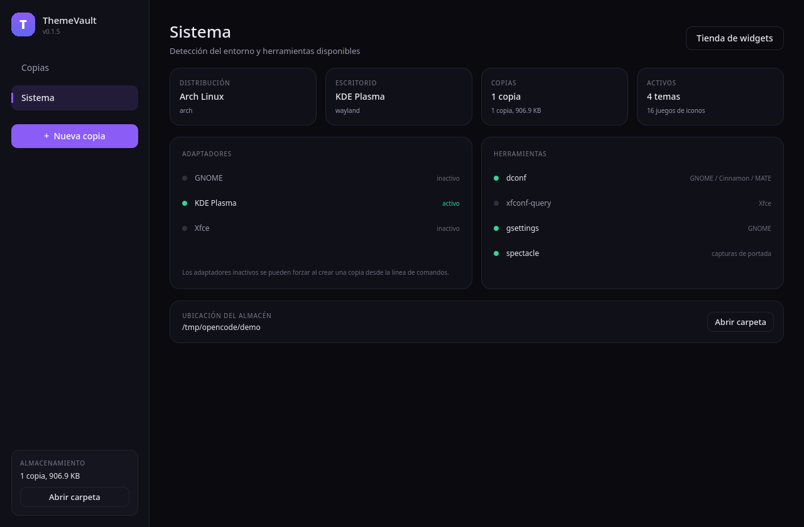

# ThemeVault

[](https://github.com/TuxArchi/themevault/actions/workflows/ci.yml)
[](https://github.com/TuxArchi/themevault/releases/latest)
[](LICENSE)
[](https://ko-fi.com/tuxarchi)

**Respaldo y restauración de la personalización del escritorio Linux.**

🌐 [Sitio del proyecto](https://tuxarchi.github.io/themevault/) · 📦 [Última versión](https://github.com/TuxArchi/themevault/releases/latest)

Guarda *fotografías del estado visual* de tu sistema —tema GTK/Qt, iconos,
cursores, fuentes, fondos, esquemas de color, widgets y barras— con una portada
compuesta (escritorio + cursor + muestra de iconos) y permite volver a
cualquiera de ellas.



> Estado: **v0.1.5**. Probado sobre KDE Plasma 6 (Wayland) y con tests de
> integración headless. Hay soporte para GNOME y Xfce, con menos horas de
> prueba real: los reportes son bienvenidos.

---

## Por qué no alcanza con copiar `~/.config`

La personalización vive en seis lugares distintos y cada DE la guarda a su
manera:

| Qué | Dónde vive | Cómo se restaura |
|---|---|---|
| Temas, iconos, cursores | `~/.themes`, `~/.icons`, `~/.local/share/{themes,icons}` | copiar árboles |
| Fuentes de usuario | `~/.local/share/fonts`, `~/.config/fontconfig` | copiar árboles |
| GNOME / Cinnamon / MATE | **dconf** (binario), incluye extensiones y dock | `dconf load` |
| Xfce | **xfconf** (XML por canal + demonio) | `xfconf-query -p … -s` |
| KDE Plasma | INI en `~/.config` + árboles en `~/.local/share` | copiar archivos |
| WMs / dotfiles | `~/.config/<wm>/` | copiar archivos |

Un backup que solo copia archivos deja los temas *instalados pero no
aplicados*. ThemeVault guarda ambas cosas: los **archivos** y los **ajustes
lógicos**.

---

## Instalación

### AppImage (recomendado)

Descargá el AppImage desde la [última release](https://github.com/TuxArchi/themevault/releases/latest):

```bash
chmod +x ThemeVault-*.AppImage
./ThemeVault-*.AppImage
```

No requiere instalar nada. Pensado para correr desde Ubuntu 22.04 en adelante,
Debian 12, Fedora 36, Arch y derivados.

> El AppImage usa el renderizador por software para funcionar con cualquier
> driver. Si querés probar aceleración por GPU: `QT_QUICK_BACKEND=opengl ./ThemeVault-*.AppImage`.

### pip

```bash
pip install "themevault[gui]"
themevault ui
```

### Desde el código

```bash
git clone https://github.com/TuxArchi/themevault
cd themevault
python3 -m venv .venv
.venv/bin/pip install -e '.[gui]'
.venv/bin/themevault detect
.venv/bin/themevault ui
```

Sin la GUI (solo CLI): `pip install themevault` y listo. Dependencias del core:
Python 3.10+ y nada más. La GUI suma `PySide6-Essentials`; `Pillow` genera
miniaturas y paletas (sin él se usa ImageMagick o se degrada con elegancia).

---

## Interfaz gráfica



Una sola ventana, tres vistas:

- **Copias**: galería con la portada compuesta de cada copia, chip del
  escritorio, fecha, tamaño y paleta. Hover → «Restaurar» directo. Con varios
  monitores, la miniatura trae botones ‹ › grandes a cada lado (con contador
  1/2) para pasar de pantalla en pantalla sin salir de la galería.
- **Detalle**: captura grande (con el mismo selector de monitor y el nombre
  de la salida, p. ej. «DP-3 1/2»), panel de datos, paleta con hex, **widgets y
  paneles con su geometría**, **muestra del tema** (cursor, iconos y una tira
  de cada barra de tareas recortada de la captura) y tarjetas por categoría.
- **Sistema**: distro, escritorio detectado, adaptadores activos, herramientas
  disponibles, ubicación del almacén.

Flujos:

- **Nueva copia** (`Ctrl+N`): nombre opcional y switch para incluir la captura.
- **Widgets y paneles**: lista de qué widget está colocado en cada panel o
  escritorio, en el orden real (`AppletOrder` en Plasma), con el nombre del
  tema y aviso si el widget no existe en este sistema. Incluye tamaño,
  posición, si el panel es flotante y su modo de ocultado.
- **Widgets de terceros**: se respaldan los que instalaste en tu usuario
  (`~/.local/share/plasma/plasmoids`). Si en la máquina destino faltan, el
  diálogo de restauración los marca y ofrece instalarlos desde la copia o
  buscarlos en la tienda.
- **Tienda de widgets**: buscador integrado sobre store.kde.org (el mismo
  proveedor que usa Plasma) para instalar sin salir de la app. Solo usa la red
  cuando buscás o instalás.
- **GNOME**: la barra superior aparece como panel (con sus extensiones) y el
  dock con sus ajustes — posición, tamaño de iconos, auto-ocultar y si está
  fijo. Al no ser una barra sólida no se recorta una tira del dock.
- **Restaurar**: abre el plan, muestra qué se puede aplicar, qué queda
  bloqueado y qué temas faltan en este sistema. Se elige por categoría y hay
  un switch para crear el punto de retorno previo.
- **Restaurar por pantalla** (KDE): si la copia tiene varias pantallas, elegís
  cuál restaurar y en qué monitor de tu equipo. Requiere reiniciar
  `plasmashell` (~2 s) y deja un `.bak` del layout por si querés volver atrás
  con `themevault revert-layout`.
- **Eliminar**: confirmación desde el detalle.
- **Actualizar** (`Ctrl+R`), `Esc` vuelve atrás.



Detalles de implementación de la UI:

- **Miniaturas en Python** (`Pillow`): 720×405 con esquinas redondeadas y caché
  en `~/.cache/themevault/thumbs`. Evita shaders y hace que la galería abra
  instantáneo.
- **Capturas fallidas detectadas**: en Wayland algunas herramientas devuelven
  una imagen negra sin error (spectacle sin portal, por ejemplo). Se detecta y
  se usa el wallpaper como portada.
- **Solo el escritorio**: antes de capturar se pide «Mostrar escritorio»
  (`kglobalaccel` en KDE, `wmctrl` en X11), así la foto no incluye ventanas
  abiertas ni la propia app. Si el escritorio no expone ese atajo, se captura
  la pantalla tal cual.
- **Multi-monitor**: se detectan los monitores (`kscreen-doctor` / `xrandr`),
  se recorta la captura por pantalla y se genera una portada por monitor.
- **Barra de tareas**: se consulta la geometría *real* de cada panel al shell
  (`location`, `offset`, `length`, `lengthMode`, `screen`) además del `.config`.
  Así se recorta la franja exacta, aunque la barra esté arriba, a la izquierda,
  sea flotante o no ocupe todo el ancho. Una tira por barra en
  `preview/panels/`. Si la barra es vertical (izquierda/derecha), la vista la
  muestra como tira alta en vez de estirarla.
- **Barras auto-ocultas**: antes de capturar se destapan por D-Bus
  (`hiding = none`) y se vuelven a ocultar al terminar, así la tira sale con
  contenido en vez de wallpaper.
- **Xfce**: la orientación se deduce del punto de anclaje (`p=6;x=960;y=1066`)
  comparándolo con el monitor, así una barra superior o lateral también se
  recorta bien.
- **Trabajos en hilo aparte**: empaquetar un tema o restaurar no congela la
  ventana.
- La GUI y la CLI comparten el mismo core: no hay dos implementaciones.

---

## Uso por CLI

```bash
themevault detect                    # distro, DE, herramientas y activos
themevault backup -m "catppuccin"    # crear copia (con captura y paleta)
themevault backup --no-preview       # copia rápida, sin captura
themevault list                      # galería en texto, con muestras de color
themevault show 20261101-100217-kde  # detalle por categoría
themevault restore <id> --dry-run    # ver el plan sin tocar nada
themevault restore <id> --only theme # restaurar solo temas
themevault restore <id> -y           # aplicar (crea punto de retorno antes)
themevault rebuild <id>              # regenerar portada y widgets de una copia
themevault install-widgets <id>      # instalar los widgets que trae la copia
themevault widgets search "clima"    # buscar en la tienda
themevault widgets install 2380036   # instalar un widget de la tienda
themevault verify <id>               # verificar hashes
themevault delete <id> -y            # borrar
themevault ui --backup <id>          # abrir la GUI en el detalle
themevault path --open               # abrir el directorio de copias
```

`restore` acepta prefijos de id, pero exige que sean únicos.

---

## Formato de una copia

Cada copia es un directorio autocontenido (se puede mover a un pendrive):

```
~/.local/share/themevault/backups/20261101-100217-kde/
├── manifest.json
├── preview/
│   ├── cover.png        portada: escritorio + cursor + iconos + paleta
│   ├── desktop.png      captura del escritorio
│   ├── wallpaper.jpg    fondo activo
│   ├── panels/          una tira por barra de tareas
│   ├── screens/         un recorte por monitor
│   └── assets/          muestras sueltas (cursor, icon-*.png)
└── files/
    └── 75/75e158…       blobs direccionados por sha256
```

`manifest.json`:

```json
{
  "schema": 1,
  "id": "20261101-100217-kde",
  "created": "2026-11-01T10:02:17-06:00",
  "host": { "distro": {"pretty": "Arch Linux"}, "de": "kde", "session": "wayland",
            "assets": {"themes": ["Breeze", "..."], "icons": ["Adwaita", "..."]},
            "skipped": [] },
  "preview": { "cover": "preview/cover.png",
               "screenshot": "preview/desktop.png",
               "wallpaper": "preview/wallpaper.jpg",
               "palette": ["#201a1b", "#0a0a06"],
               "themes": { "icons": "breeze-dark", "cursor": "breeze_cursors" },
               "samples": { "cursor": "preview/assets/cursor.png",
                            "icons": ["preview/assets/icon-0.png"] } },
  "containers": [
    { "kind": "panel", "name": "Panel inferior", "location": "inferior",
      "size": 46, "floating": true, "visibility": "esquivar ventanas",
      "order": ["4","5","6","7","8","23","24"], "widgets": 7 }
  ],
  "widgets": [
    { "id": "org.kde.plasma.digitalclock", "name": "Reloj digital",
      "kind": "plasmoid", "container": "Panel inferior",
      "position": 6, "installed": true }
  ],
  "items": [
    { "kind": "tree", "category": "theme", "name": "MiTema",
      "source": "~/.themes/MiTema", "blob": "files/1a/1ac2…",
      "sha256": "1ac2…", "size": 4096, "meta": {"files": 12} },
    { "kind": "dconf", "category": "theme", "name": "Apariencia GNOME",
      "backend": "dconf", "data": {"path": "/org/gnome/desktop/interface/"},
      "blob": "files/9f/9f2a…" },
    { "kind": "setting", "category": "theme", "name": "xsettings:/Net/ThemeName",
      "backend": "xfconf",
      "data": {"channel": "xsettings", "prop": "/Net/ThemeName",
               "type": "string", "value": "Adwaita-dark"} }
  ]
}
```

Cuatro tipos de item:

- **file** — archivo suelto (`kdeglobals`, `settings.ini`, `.colors`).
- **tree** — árbol empaquetado en `tar.gz` determinista (mtime/uid normalizados,
  así el hash depende solo del contenido: dos copias del mismo tema deduplican
  de verdad).
- **dconf** — volcado de texto de una rama de dconf.
- **setting** — ajuste puntual aplicado por CLI (xfconf).

Las rutas se guardan como `~/...`, no absolutas: una copia hecha en
`/home/ana` se restaura igual en `/home/luis`.

Los temas de `/usr/share` **no se copian**: se registra su nombre en
`host.assets`. Evita copias de cientos de MB y problemas de licencia con
fuentes comerciales.

---

## Restauración segura

1. **Plan primero.** La GUI (y `--dry-run`) muestra qué se aplicará, qué está
   bloqueado y por qué.
2. **Punto de retorno automático.** Antes de tocar nada se crea otra copia
   etiquetada *Punto de restauración*. Todo cambio es reversible.
3. **Restauración selectiva** por categoría.
4. **Nunca escribe fuera de `$HOME`.** Cualquier item con ruta externa queda
   bloqueado en el plan.
5. **Aviso de dependencias.** Si la copia referencia temas o iconos que este
   sistema no tiene, se avisa antes de aplicar.
6. **Escrituras atómicas.** Archivos vía `tmp` + `os.replace`; árboles se
   extraen a un staging y se intercambian, con rollback si el intercambio falla.

---

## Arquitectura

```
GUI (Qt6/QML)              CLI (themevault …)
      \                       /
       core: backup · plan · restore · verify
               |
     adaptadores por DE (plugins)
     gnome · kde · xfce · (cinnamon · mate · …)
               |
     drivers: files · dconf · xfconf
```

```
src/themevault/
├── cli.py           interfaz de línea de comandos
├── model.py         Item, Manifest, categorías
├── store.py         blobs sha256 + tar determinista
├── detect.py        distro, DE, sesión, activos instalados
├── drivers.py       dconf (dump/load) y xfconf (XML + query)
├── preview.py       captura, wallpaper, paleta
├── cover.py         portada compuesta (cursor + iconos + paleta)
├── widgets.py       paneles, widgets y geometría por DE
├── backup.py        motor de respaldo
├── restore.py       plan, aplicación, rollback
├── adapters/
│   ├── base.py      Collector + contrato de adaptador
│   ├── gnome.py     dconf
│   ├── kde.py       INI + árboles
│   └── xfce.py      xfconf
└── ui/
    ├── app.py       arranque de la GUI
    ├── bridge.py    puente Python <-> QML (trabajos en hilo)
    ├── models.py    modelo de la galería
    ├── thumbs.py    miniaturas cacheadas
    └── qml/         Main, GalleryPage, DetailPage, RestoreDialog…
```

El core no sabe de GNOME ni de KDE: solo habla con adaptadores.

### Agregar un entorno nuevo

```python
from .base import Adapter, Collector

class CinnamonAdapter(Adapter):
    id = "cinnamon"
    label = "Cinnamon"

    def _collect(self, collector: Collector) -> None:
        collector.add_dconf("/org/cinnamon/desktop/interface/", "theme", "Apariencia")
        collector.add_dconf("/org/cinnamon/desktop/background/", "wallpaper", "Fondo")
        collector.add_children_as_trees("~/.local/share/cinnamon/theme", "theme")
```

Y registrarlo en `adapters/__init__.py`. No hay que tocar el core ni la GUI.

---

## Tests

```bash
.venv/bin/pip install pytest
.venv/bin/python -m pytest -q
```

- `tests/test_core.py`: blobs, dedupe, round-trip de árboles, plan bloqueado
  fuera del home, parseo de xfconf.
- `tests/test_ui_bridge.py`: flujo completo del backend de la GUI (crear copia,
  plan, detalle, restaurar, errores) con un `HOME` temporal, sin abrir ventanas.
- `tests/test_widgets.py`: parser de Plasma (panel, geometría, `AppletOrder`,
  widgets ocultos, detección de instalación) y de Xfce.
- `tests/test_cover.py`: composición de la portada, captura negra descartada,
  búsqueda de iconos en un tema falso.

---

## Empaquetado

`packaging/themevault.desktop` + `src/themevault/ui/qml/themevault.svg` sirven
para instalarlo en el menú de aplicaciones. Para capturas automáticas o CI,
`themevault-gui --screenshot salida.png [--backup <id>] [--action restore|new]`.

---

## Apoyar el proyecto

ThemeVault es libre, sin anuncios ni telemetría, y lo mantengo en mi tiempo
libre. Si te resulta útil —o te salvó de rearmar el escritorio a mano— podés
**invitarme un café**:

<a href="https://ko-fi.com/tuxarchi"></a>

También ayuda muchísimo: reportar bugs con buenos datos, probarlo en tu
distribución y mandar un pull request.

---

## Roadmap

| Fase | Contenido | Estado |
|---|---|---|
| 1 | Core + CLI, adaptadores GNOME/KDE/XFCE, previews, restore seguro | **hecho** |
| 2 | GUI Qt6/QML: galería, detalle, restore selectivo | **hecho** |
| 3 | Resolver de paquetes (apt/dnf/pacman/zypper), restore cruzado entre DEs | pendiente |
| 3.5 | Widgets, paneles y geometría + portada compuesta | **hecho** |
| 4 | Adaptadores Nivel 2 (Cinnamon, MATE, Budgie, LXQt) + modo genérico dotfiles | pendiente |
| 5 | Empaquetado (AppImage, deb/rpm, AUR), i18n | pendiente |

---

## Limitaciones conocidas

- Restaurar entre versiones mayores del mismo DE (Plasma 5 → 6, GNOME 45 → 48)
  puede necesitar migración de esquemas: se avisa, no se promete.
- Xfce: las propiedades de tipo *array* se omiten (se informan como omitidas).
- Los temas de `/usr/share` deben existir en la máquina destino; si no, se verá
  el tema de fallback (por eso existe el aviso previo).
- En Wayland, la captura de pantalla depende del compositor: si falla, la
  portada muestra el wallpaper (y no hay tiras de barras).
- Los docks de terceros (Plank, Latte, Waybar) no tienen parser propio: no
  generan tira. El de GNOME se muestra como ajustes, no como imagen.
- En GNOME el alto de la barra superior es fijo y se asume 40 px para el
  recorte; con escalados raros la franja puede quedar algo alta.
- Flatpak como formato de distribución está descartado: el sandbox bloquea justo
  lo que la app necesita.
